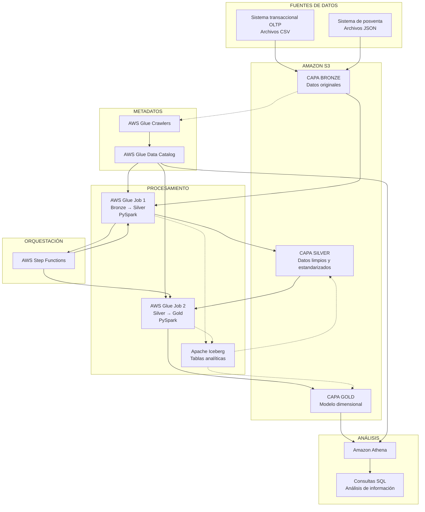
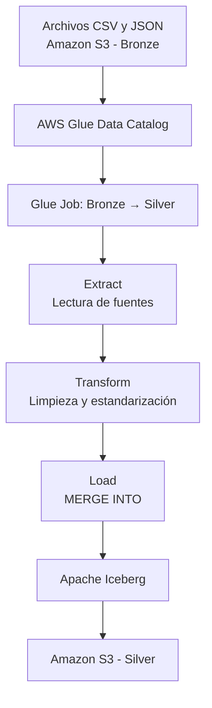
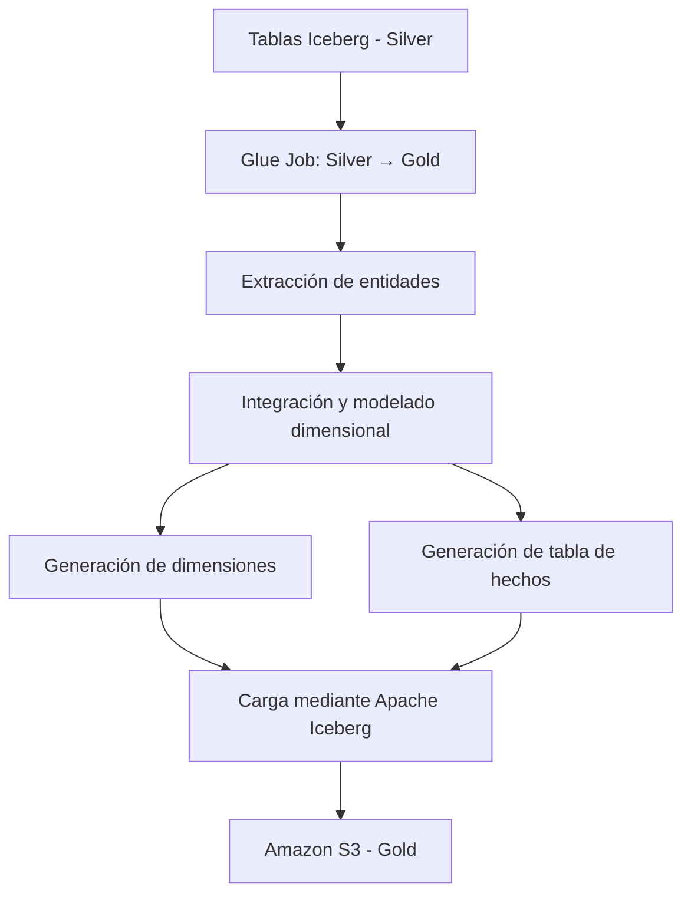
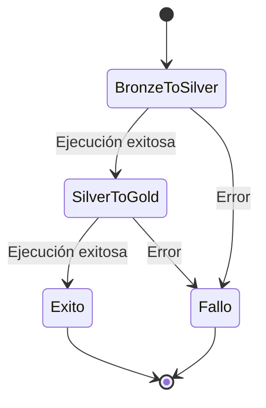

# Documento de Arquitectura
# TechStore LakeHouse

**Proyecto:** Implementación de una arquitectura Data Lakehouse en AWS mediante Infrastructure as Code.

**Organización:** Universidad de Pamplona  
**Dominio:** Cadena de tiendas de tecnología  
**Versión del documento:** 1.0  
**Estado:** Arquitectura definida y componentes en desarrollo.

---

# 1. Introducción

## 1.1. Propósito

Este documento describe la arquitectura tecnológica y lógica de TechStore LakeHouse, una solución de ingeniería de datos diseñada para integrar, almacenar, procesar y analizar información proveniente de diferentes sistemas de una cadena de tiendas de tecnología.

La arquitectura está implementada sobre Amazon Web Services (AWS) y adopta el paradigma Data Lakehouse, combinando las capacidades de almacenamiento flexible de un Data Lake con las características de administración, consistencia y consulta estructurada de un Data Warehouse.

La infraestructura se administra mediante Infrastructure as Code (IaC), utilizando Terraform, mientras que los procesos de integración y transformación de datos se desarrollan mediante AWS Glue y PySpark.

El documento presenta los componentes principales, sus responsabilidades, los flujos de procesamiento, la organización de los datos, las decisiones arquitectónicas y los mecanismos utilizados para garantizar la integridad y disponibilidad de la información.

## 1.2. Alcance

La arquitectura contempla:

- Integración de datos estructurados provenientes de sistemas transaccionales OLTP.
- Integración de datos semiestructurados provenientes de sistemas de posventa.
- Almacenamiento de información en Amazon S3.
- Organización de datos mediante las capas Bronze, Silver y Gold.
- Procesamiento distribuido utilizando Apache Spark y PySpark.
- Administración de tablas analíticas mediante Apache Iceberg.
- Registro y administración de metadatos mediante AWS Glue Data Catalog.
- Orquestación de procesos ETL mediante AWS Step Functions.
- Consulta de información mediante Amazon Athena.
- Aprovisionamiento y administración de infraestructura mediante Terraform.

---

# 2. Contexto del negocio

## 2.1. Descripción de TechStore

TechStore representa una cadena ficticia de tiendas especializadas en la comercialización de productos tecnológicos.

La organización dispone de diferentes sistemas que generan información durante sus operaciones comerciales y procesos posteriores a la venta.

Entre estos sistemas se encuentran:

**Sistema transaccional (OLTP):**

Almacena información estructurada relacionada con clientes, productos, marcas, sucursales, ventas, detalles de ventas y métodos de pago.

**Sistema de posventa:**

Registra información relacionada con garantías y devoluciones. Estos registros contienen estructuras semiestructuradas que pueden incluir atributos anidados, como motivos y estados de los procesos.

## 2.2. Problemática

La información generada por los diferentes sistemas se encuentra distribuida en múltiples fuentes y formatos.

Esta situación dificulta:

- La integración de información entre los sistemas.
- La consolidación de los registros comerciales.
- La consulta de información histórica.
- La realización de análisis relacionados con las ventas y los productos.
- La identificación de patrones de comportamiento comercial.
- La generación de información centralizada para apoyar la toma de decisiones.

Por esta razón, se plantea una arquitectura centralizada que permita integrar las fuentes de información y transformarlas progresivamente en datos preparados para el análisis.

## 2.3. Objetivo arquitectónico

Construir una plataforma de datos escalable y reproducible que permita centralizar la información de TechStore, procesarla mediante diferentes etapas de transformación y proporcionar una estructura analítica que facilite la generación de conocimiento a partir de los datos.

---

# 3. Visión general de la arquitectura

La solución adopta una arquitectura Data Lakehouse basada en Amazon S3, AWS Glue, Apache Spark, Apache Iceberg y Amazon Athena.

Los datos se organizan en tres capas:

1. **Bronze:** almacenamiento de los datos originales.
2. **Silver:** datos limpios, validados y estandarizados.
3. **Gold:** datos organizados para análisis mediante un modelo dimensional.

La comunicación entre los componentes se realiza mediante servicios administrados de AWS y procesos ETL desarrollados con PySpark.

## 3.1. Diagrama general



**Nota:** El diagrama representa la arquitectura lógica. Las conexiones punteadas indican relaciones de catálogo y administración de tablas, no transferencias directas de archivos. La orquestación controla la secuencia de ejecución de los Glue Jobs.

---

# 4. Componentes tecnológicos

## 4.1. Amazon S3

Amazon Simple Storage Service (S3) constituye la base de almacenamiento de la arquitectura.

Su responsabilidad es almacenar los datos provenientes de las fuentes originales y los resultados generados durante los procesos de transformación.

Se utiliza una organización lógica mediante prefijos que representan las diferentes capas del Data Lakehouse.

Estructura conceptual:

```text
techstore-lakehouse/
│
├── bronze/
│   ├── clientes/
│   ├── marcas/
│   ├── productos/
│   ├── sucursales/
│   ├── metodos_pago/
│   ├── ventas/
│   ├── detalle_ventas/
│   ├── garantias/
│   └── devoluciones/
│
├── silver/
│   └── warehouse/
│
├── gold/
│   └── warehouse/
│
├── scripts/
│   ├── bronze_to_silver.py
│   ├── silver_to_gold.py
│   └── src.zip
│
└── warehouse/
    └── Tablas administradas mediante Apache Iceberg
```

La estructura física definitiva depende de la configuración de almacenamiento utilizada por los procesos ETL y de las ubicaciones registradas en el catálogo.

## 4.2. AWS Glue

AWS Glue es el servicio encargado de ejecutar los procesos de integración y transformación de datos.

Se utiliza principalmente para:

- Ejecutar trabajos ETL.
- Procesar información mediante PySpark.
- Acceder a los metadatos del Glue Data Catalog.
- Integrar los datos con Apache Iceberg.
- Escribir los resultados en Amazon S3.

La arquitectura contempla dos trabajos principales:

**Glue Job 1: Bronze → Silver**

Procesa los datos originales, aplica transformaciones, realiza validaciones y genera las tablas de la capa Silver.

**Glue Job 2: Silver → Gold**

Utiliza la información estandarizada de Silver para construir el modelo dimensional y generar las tablas analíticas de Gold.

## 4.3. AWS Glue Data Catalog

Glue Data Catalog funciona como repositorio centralizado de metadatos.

Permite registrar información sobre las bases de datos y tablas disponibles dentro del Lakehouse.

Entre sus responsabilidades se encuentran:

- Registrar las tablas de las diferentes capas.
- Almacenar esquemas y metadatos.
- Facilitar el descubrimiento de información.
- Permitir que Glue y Athena accedan a las definiciones de las tablas.

Se contemplan bases de datos lógicas independientes para cada capa:

- `bronze`
- `silver`
- `gold`

Los Crawlers de Glue se utilizan para descubrir esquemas y registrar metadatos de las fuentes cuando corresponda. Las tablas administradas mediante Iceberg utilizan su integración con Glue Data Catalog para registrar y consultar sus metadatos.

## 4.4. Apache Spark y PySpark

Apache Spark es el motor de procesamiento distribuido utilizado en los trabajos ETL.

PySpark proporciona la interfaz de programación en Python para desarrollar las transformaciones.

Su utilización permite:

- Procesar grandes volúmenes de registros.
- Realizar transformaciones distribuidas.
- Ejecutar operaciones de limpieza y validación.
- Integrar diferentes fuentes de información.
- Construir conjuntos de datos preparados para el análisis.

La implementación utiliza una estructura modular para separar las responsabilidades de extracción, transformación y carga.

## 4.5. Apache Iceberg

Apache Iceberg es el formato de tablas utilizado para administrar los datos analíticos de las capas Silver y Gold.

A diferencia de almacenar únicamente archivos independientes en S3, Iceberg permite administrar los datos mediante tablas con metadatos y snapshots.

Entre sus funcionalidades se encuentran:

- Operaciones de inserción y actualización.
- Operaciones MERGE.
- Administración de snapshots.
- Consultas históricas mediante Time Travel.
- Evolución de esquemas.
- Administración de archivos de datos y metadatos.

Se utiliza el formato de tablas Iceberg versión 2, que permite trabajar con operaciones de actualización y eliminación de registros.

## 4.6. AWS Step Functions

AWS Step Functions es el servicio encargado de coordinar la ejecución de los procesos ETL.

Su responsabilidad es garantizar que los trabajos se ejecuten en el orden establecido.

Flujo de ejecución:

1. Iniciar el Glue Job Bronze → Silver.
2. Esperar a que termine su ejecución.
3. Si finaliza correctamente, iniciar Silver → Gold.
4. Esperar a que termine el segundo trabajo.
5. Finalizar el pipeline con estado exitoso o fallido.

El patrón de integración `glue:startJobRun.sync` permite que Step Functions espere la finalización del trabajo antes de continuar.

En caso de error, la máquina de estados dirige la ejecución hacia un estado de fallo.

## 4.7. Amazon Athena

Amazon Athena es el servicio utilizado para realizar consultas analíticas sobre los datos almacenados en S3.

Permite utilizar SQL sin necesidad de administrar servidores de bases de datos.

Su integración con Glue Data Catalog facilita el acceso a las tablas registradas en el Lakehouse.

Entre sus posibles usos se encuentran:

- Consultar información de ventas.
- Analizar productos y marcas.
- Consultar el comportamiento de las sucursales.
- Identificar patrones comerciales.
- Analizar garantías y devoluciones.
- Consultar información histórica de tablas Iceberg mediante Time Travel.

## 4.8. Terraform

Terraform se utiliza para definir, aprovisionar y administrar la infraestructura de AWS mediante código.

Su utilización permite:

- Mantener una definición reproducible de la infraestructura.
- Versionar los cambios de configuración.
- Reducir la intervención manual.
- Facilitar la creación y eliminación controlada de recursos.
- Mantener consistencia entre los entornos.

Los recursos se organizan mediante archivos `.tf` que separan las responsabilidades de almacenamiento, catálogo, permisos, Glue y servicios analíticos.

---

# 5. Arquitectura por capas

La organización de los datos sigue el patrón Medallion Architecture.

Cada capa representa una etapa de procesamiento y preparación de la información.

## 5.1. Capa Bronze

### Propósito

Almacenar los datos originales provenientes de los sistemas de origen.

Esta capa constituye el punto inicial del procesamiento y busca conservar la información recibida sin aplicar transformaciones de negocio que alteren su significado.

### Características

- Conservación de los datos originales.
- Separación por entidades o fuentes.
- Almacenamiento de archivos CSV y JSON.
- Identificación de las fuentes de información.
- Disponibilidad para procesos posteriores.

### Fuentes contempladas

| Fuente | Formato | Descripción |
|---|---|---|
| Clientes | CSV | Información de los clientes. |
| Marcas | CSV | Marcas comercializadas. |
| Productos | CSV | Catálogo de productos. |
| Sucursales | CSV | Información de las tiendas. |
| Métodos de pago | CSV | Métodos utilizados en las transacciones. |
| Ventas | CSV | Registros de operaciones comerciales. |
| Detalles de ventas | CSV | Productos asociados a cada venta. |
| Garantías | JSON | Registros de garantías. |
| Devoluciones | JSON | Registros de devoluciones. |

### Consideraciones

La capa Bronze conserva los nombres y estructuras originales de las fuentes.

Los datos se registran en Glue Data Catalog para facilitar su descubrimiento y lectura durante el proceso Bronze → Silver.

## 5.2. Capa Silver

### Propósito

Almacenar información limpia, validada y estandarizada.

Esta capa transforma los registros originales en estructuras más consistentes, adecuadas para su integración y utilización en procesos analíticos posteriores.

### Transformaciones contempladas

- Estandarización de nombres de columnas.
- Conversión de tipos de datos.
- Normalización de formatos.
- Validación de claves primarias.
- Tratamiento de registros nulos.
- Limpieza de información inconsistente.
- Incorporación de metadatos de auditoría.

### Estandarización

Los nombres originales en español se transforman a inglés utilizando el formato `snake_case`.

Ejemplo:

| Bronze | Silver |
|---|---|
| `id_cliente` | `customer_id` |
| `nombre` | `name` |
| `fecha_venta` | `sale_date` |
| `id_producto` | `product_id` |
| `precio_unitario` | `unit_price` |

### Metadatos de auditoría

Se contempla incorporar atributos que permitan identificar información relacionada con el procesamiento:

- `_ingestion_timestamp`: fecha y hora de incorporación del registro.
- `_ingestion_batch`: identificador del lote de procesamiento.

Estos atributos permiten mejorar la trazabilidad y facilitar el análisis de los procesos de carga.

### Almacenamiento

La capa Silver utiliza tablas administradas mediante Apache Iceberg.

Esto permite ejecutar operaciones de inserción y actualización, así como mantener snapshots de los datos.

## 5.3. Capa Gold

### Propósito

Organizar los datos para facilitar el análisis y la generación de información útil para el negocio.

Esta capa representa la etapa de modelado analítico del Lakehouse.

Se contempla implementar un modelo dimensional tipo estrella, compuesto por tablas de hechos y dimensiones.

### Modelo dimensional propuesto

**Dimensiones:**

- DimCustomer.
- DimProduct.
- DimBrand.
- DimBranch.
- DimPaymentMethod.
- DimDate.

**Tabla de hechos:**

- FactSales.

La tabla de hechos permite analizar las operaciones comerciales mediante relaciones con las dimensiones correspondientes.

### Consideraciones de diseño

- Utilización de claves sustitutas deterministas.
- Conservación de relaciones entre hechos y dimensiones.
- Evitar duplicación de importes de cabecera al integrar detalles de ventas.
- Validación de integridad referencial.
- Administración de tablas mediante Apache Iceberg.

La estructura definitiva del modelo depende de las reglas de negocio y de las relaciones existentes en las fuentes originales.

---

# 6. Flujos de procesamiento de datos

## 6.1. Flujo de ingestión

El proceso comienza con la disponibilidad de los archivos generados por los sistemas de origen.

Los archivos CSV y JSON se almacenan en las ubicaciones correspondientes de Amazon S3 dentro de la capa Bronze.

Posteriormente, AWS Glue Data Catalog registra los metadatos necesarios para que los procesos ETL puedan acceder a las fuentes.

## 6.2. Flujo Bronze → Silver



El primer proceso ETL se organiza en tres etapas principales.

**Extract:**

Lee las tablas registradas en Glue Data Catalog y obtiene los datos originales.

**Transform:**

Aplica las reglas de limpieza, validación, estandarización y conversión de tipos de datos.

**Load:**

Escribe los resultados en tablas Iceberg de Silver mediante operaciones de carga y actualización.

Se contempla utilizar operaciones `MERGE INTO` para evitar duplicaciones y permitir actualizar registros existentes.

## 6.3. Flujo Silver → Gold



El segundo proceso utiliza los datos preparados en Silver para construir las estructuras analíticas de Gold.

Las transformaciones contemplan la integración de entidades, construcción de dimensiones, generación de hechos y asignación de claves sustitutas.

## 6.4. Orquestación del pipeline

La ejecución completa se coordina mediante AWS Step Functions.



La utilización del patrón de ejecución síncrona permite controlar la secuencia de los procesos y evitar que Silver → Gold comience antes de que Bronze → Silver haya terminado.

La gestión de errores permite identificar ejecuciones fallidas y evitar que el pipeline continúe normalmente cuando una etapa no se completa.

---

# 7. Administración de datos y consistencia

## 7.1. Estrategia de carga

La arquitectura contempla cargas iniciales y cargas incrementales.

**Carga inicial:**

Permite incorporar los registros existentes en las fuentes al Lakehouse.

**Carga incremental:**

Permite incorporar registros nuevos y actualizar registros existentes sin necesidad de reconstruir completamente las tablas.

La implementación utiliza operaciones de combinación de datos mediante Apache Iceberg.

## 7.2. Idempotencia

Los procesos deben diseñarse para que la repetición de una ejecución no genere duplicaciones innecesarias.

Para ello se contempla:

- Identificación de claves primarias.
- Validación de registros antes de la escritura.
- Operaciones `MERGE INTO`.
- Actualización de registros existentes.
- Inserción de registros nuevos.
- Identificación de lotes de procesamiento.

La idempotencia es especialmente importante cuando un trabajo falla y necesita ejecutarse nuevamente.

## 7.3. Time Travel

Apache Iceberg administra snapshots que representan diferentes estados de una tabla.

Esta funcionalidad permite consultar versiones anteriores de los datos y analizar cómo ha cambiado la información a través del tiempo.

Se contempla utilizar Time Travel para:

- Consultar estados históricos.
- Comparar versiones de una tabla.
- Verificar cambios realizados durante las cargas.
- Facilitar auditorías de información.

---

# 8. Infraestructura y despliegue

## 8.1. Aprovisionamiento mediante Terraform

Los recursos de AWS se definen mediante archivos de configuración Terraform.

La organización modular permite mantener separadas las definiciones de los diferentes componentes.

Entre los recursos contemplados se encuentran:

| Componente | Responsabilidad |
|---|---|
| Amazon S3 | Almacenamiento de datos y scripts. |
| IAM | Roles y políticas de acceso. |
| Glue Data Catalog | Bases de datos y metadatos. |
| Glue Crawlers | Descubrimiento de esquemas. |
| AWS Glue Jobs | Ejecución de procesos ETL. |
| Amazon Athena | Consultas analíticas. |
| AWS Step Functions | Orquestación de procesos. |

## 8.2. Proceso de despliegue

El despliegue de la infraestructura sigue el siguiente procedimiento:

1. Configuración del entorno local.
2. Configuración de credenciales AWS.
3. Inicialización de Terraform.
4. Validación de archivos de infraestructura.
5. Generación y revisión del plan.
6. Aprovisionamiento de recursos.
7. Publicación de scripts ETL en S3.
8. Ejecución de los procesos de integración.

Los cambios de infraestructura deben revisarse antes de aplicarse para evitar modificaciones o eliminaciones accidentales de recursos existentes.

## 8.3. Organización del código

La solución separa los componentes de procesamiento de los archivos utilizados para desplegar los trabajos en AWS Glue.

Estructura conceptual:

```text
TechStore-LakeHouse/
│
├── deployment/
│   └── glue/
│       ├── bronze_to_silver.py
│       └── silver_to_gold.py
│
├── src/
│   ├── common/
│   │   └── spark_session.py
│   │
│   └── jobs/
│       ├── bronze_to_silver/
│       │   ├── extract.py
│       │   ├── transform.py
│       │   ├── load_iceberg.py
│       │   └── main.py
│       │
│       └── silver_to_gold/
│
├── scripts/
│   ├── generators/
│   ├── json_generators/
│   └── datasets/
│
├── terraform/
│
└── README.md
```

Los archivos ubicados en `deployment/glue/` funcionan como puntos de entrada para los trabajos de AWS Glue.

El directorio `src/` contiene la implementación modular de los procesos ETL.

---

# 9. Seguridad y control de acceso

La arquitectura utiliza AWS Identity and Access Management (IAM) para administrar los permisos de los servicios.

Se contemplan roles independientes para los diferentes componentes.

**Rol de AWS Glue:**

Permite que los trabajos ETL accedan a los recursos necesarios para leer y escribir información en Amazon S3 y utilizar los servicios correspondientes.

**Rol de AWS Step Functions:**

Permite que la máquina de estados inicie, consulte y gestione las ejecuciones de los trabajos AWS Glue.

La separación de roles permite aplicar el principio de mínimo privilegio.

Se consideran las siguientes buenas prácticas:

- No almacenar credenciales directamente en el código.
- No publicar archivos de variables sensibles.
- Excluir archivos de estado de Terraform del control de versiones.
- Limitar los permisos IAM a los recursos necesarios.
- Evitar permisos administrativos innecesarios.
- Mantener separados los permisos de ejecución y administración.

---

# 10. Consulta y explotación analítica

Amazon Athena proporciona la interfaz SQL para consultar la información disponible en las tablas del Lakehouse.

La capa Gold constituye el principal punto de consumo analítico, debido a que sus estructuras están diseñadas para facilitar consultas relacionadas con las operaciones del negocio.

Ejemplos de análisis que podrían desarrollarse:

- Ventas por sucursal.
- Productos más vendidos.
- Ingresos por marca.
- Comportamiento de ventas por período.
- Métodos de pago más utilizados.
- Distribución de ventas por producto.
- Cantidad de garantías y devoluciones.
- Comparación entre períodos comerciales.

La disponibilidad de estas consultas depende de la implementación y validación del modelo dimensional.

---

# 11. Decisiones arquitectónicas

| Decisión | Justificación |
|---|---|
| Utilizar Amazon S3 como almacenamiento central | Permite almacenar grandes volúmenes de datos de manera flexible y desacoplada del procesamiento. |
| Implementar tres capas Bronze, Silver y Gold | Facilita la organización, trazabilidad y evolución de los datos. |
| Utilizar AWS Glue | Proporciona procesamiento ETL administrado e integración con el catálogo de datos. |
| Utilizar PySpark | Permite ejecutar transformaciones distribuidas sobre grandes volúmenes de información. |
| Utilizar Apache Iceberg | Proporciona administración transaccional de tablas y funcionalidades de versionado. |
| Utilizar Glue Data Catalog | Centraliza los metadatos y facilita el acceso a las tablas. |
| Utilizar Step Functions | Permite coordinar los trabajos ETL y controlar su secuencia de ejecución. |
| Utilizar Athena | Permite consultar los datos mediante SQL sin administrar infraestructura de servidores. |
| Utilizar Terraform | Permite aprovisionar y administrar recursos mediante código reproducible. |

---

# 12. Consideraciones de rendimiento y escalabilidad

La arquitectura está diseñada para procesar volúmenes importantes de información mediante procesamiento distribuido.

Se consideran los siguientes aspectos:

- Distribución del procesamiento mediante Apache Spark.
- Uso adecuado de particionamiento cuando las características de los datos lo justifiquen.
- Control del tamaño de archivos almacenados en S3.
- Optimización de consultas mediante Athena.
- Reducción de lecturas y escrituras innecesarias.
- Uso de operaciones de actualización eficientes en Apache Iceberg.
- Configuración apropiada de los recursos de cómputo de AWS Glue.

La escalabilidad depende de la configuración de los trabajadores de Glue, el diseño de las transformaciones y la organización física de las tablas.

---

# 13. Limitaciones y aspectos pendientes

La arquitectura representa la solución definida para el proyecto académico. Su grado de implementación puede variar entre componentes.

Los aspectos que requieren implementación o validación integral incluyen:

- Finalización del proceso Silver → Gold.
- Validación de las transformaciones de las fuentes JSON anidadas.
- Verificación de idempotencia mediante reejecuciones.
- Pruebas de cargas incrementales.
- Validación de operaciones MERGE sobre las tablas Iceberg.
- Pruebas de consultas Time Travel.
- Validación de la orquestación completa mediante Step Functions.
- Evaluación de rendimiento sobre el volumen total de información.

Estas actividades permiten comprobar que los componentes definidos arquitectónicamente funcionan de manera integrada.

---

# 14. Conclusiones

TechStore LakeHouse propone una arquitectura de datos moderna que integra diferentes fuentes de información y las transforma progresivamente en estructuras preparadas para el análisis.

La utilización de Amazon S3, AWS Glue, Apache Spark, Apache Iceberg y Amazon Athena permite construir una plataforma que combina almacenamiento flexible, procesamiento distribuido, administración de tablas y consultas analíticas.

La incorporación de Terraform permite administrar la infraestructura como código, facilitando su reproducción y mantenimiento.

Por su parte, AWS Step Functions proporciona un mecanismo de orquestación para coordinar los procesos ETL y controlar su ejecución.

La separación de los datos en las capas Bronze, Silver y Gold establece una organización clara de las responsabilidades de ingestión, transformación y modelado analítico.

En conjunto, estos componentes conforman una solución Data Lakehouse orientada a centralizar la información de TechStore y proporcionar una base tecnológica para el análisis y la toma de decisiones.

---

**Fin del documento.**

**TechStore LakeHouse**  
*Transformando datos en información para la toma de decisiones.*

## 15. Diagrama de infraestructura AWS

El siguiente diagrama presenta la infraestructura diseñada para TechStore LakeHouse, incluyendo los servicios de AWS involucrados, sus relaciones y el flujo general de procesamiento de datos desde las fuentes de origen hasta la capa analítica.

