# Bitácora - Luis David Maldonado Suárez (Infraestructura / Terraform)

Proyecto: TechStore Lakehouse. 

Formato de cada entrada: Qué hice / Qué aprendí o qué falló / Evidencia.

---

## 6 de noviembre de 2026 - Base de Terraform

**Qué hice**
- Configuré el perfil `techstore` en AWS CLI con las llaves del usuario IAM compartido (las llaves quedan en `~/.aws/credentials`, fuera del repo).
- Verifiqué la conexión con `aws sts get-caller-identity --profile techstore`.
- Escribí el provider AWS (región us-east-1, perfil techstore) con `default_tags`: Project, Course, Owner, Environment, ManagedBy.
- Ejecuté `terraform init` (se generó `.terraform.lock.hcl`, que sí se sube a Git).
- Definí el recurso `aws_budgets_budget` (10 USD mensual) con 5 alertas: 2 USD, 5 USD, 80%, 100% real y 100% proyectado. Los correos de ambos integrantes están en `var.alert_email`.

**Qué aprendí**
- El provider es el traductor entre Terraform y AWS. Terraform no tiene permisos propios: usa los del usuario IAM.
- `default_tags` pone etiquetas a todos los recursos sin repetirlas.
- Budgets avisa pero no frena el gasto. `ABSOLUTE_VALUE` se lee en dólares y `PERCENTAGE` depende del límite.
- `terraform plan` solo muestra; `apply` es el que crea.

**Evidencia**
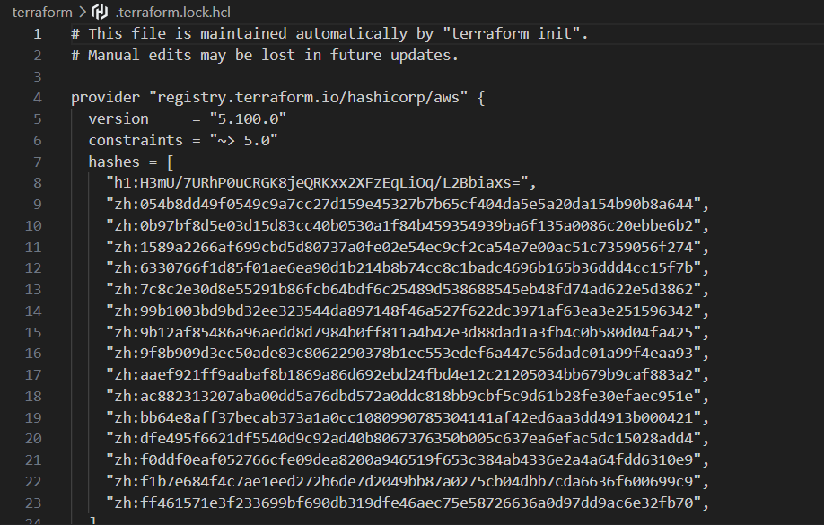
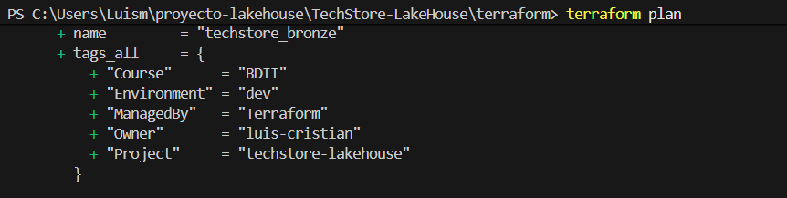
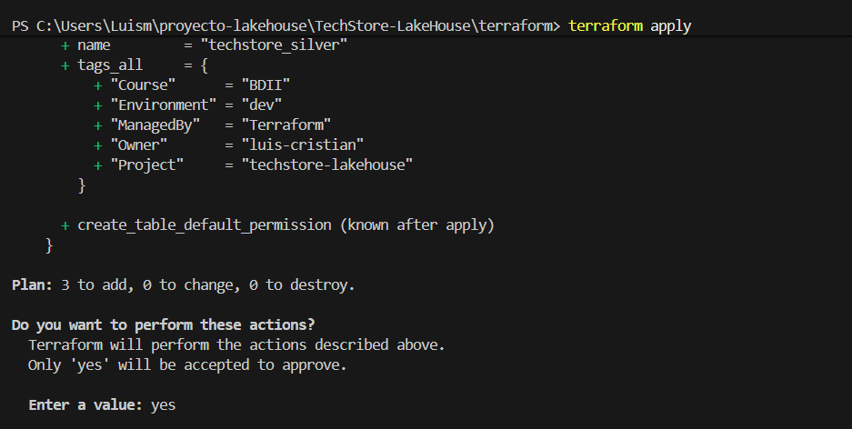
---

## 7 de noviembre de 2026 - Bucket S3, revisión de datos e IAM

**Qué hice**
- Decisión de diseño: un solo bucket S3 (aprobado por el profesor). Las capas son prefijos: `bronze/`, `silver/`, `gold/`, `scripts/`, `athena-results/`.
- El tfstate queda local. Solo yo corro `apply`, para no tener dos estados distintos.
- Organicé el código por archivos: `s3.tf`, `locals.tf`, `outputs.tf`, `iam.tf`, `glue_catalog.tf`.
- Creé el bucket `techstore-lakehouse-<id-cuenta>` con `aws_s3_bucket` y `aws_s3_bucket_public_access_block` (todo bloqueado). El nombre se arma con un `local` y `aws_caller_identity`.
- `force_destroy = true`: decisión consciente para que el `terraform destroy` del 13 de nov funcione aunque el bucket tenga datos.
- Verifiqué el bucket con `aws s3 ls --profile techstore`.
- Creé el rol IAM de Glue (`techstore-glue-role`): trust policy para `glue.amazonaws.com`, política administrada `AWSGlueServiceRole` y política propia con acceso al bucket (ListBucket sobre el bucket y Get/Put/DeleteObject sobre `/*`).
- Escribí las tres bases de datos del catálogo: `techstore_bronze`, `techstore_silver`, `techstore_gold` (apply pendiente, confirmar).

**Qué aprendí**
- Los nombres de bucket son únicos en todo AWS, por eso el id de cuenta en el nombre.
- En S3 las carpetas no existen: un prefijo aparece cuando alguien sube un objeto con esa ruta.
- El tfstate no es una copia de seguridad: es el mapa de lo que Terraform maneja. Lo que recrea todo son los archivos `.tf` en Git.
- Trust policy = quién puede asumir el rol. Política de permisos = qué puede hacer. Darle a Glue mi usuario IAM iría contra el mínimo privilegio.
- Glue es el servicio que corre Spark sin administrar un cluster; el DPU es su unidad de poder.
- El Data Catalog es uno solo por cuenta y región; las bases (bronze, silver, gold) son como carpetas dentro de él. Borrar una base no borra los archivos de S3.
- El Crawler descubre esquemas de Bronze. Silver y Gold los crean los jobs de Spark al escribir en Iceberg.
- Un lote es una entrega de datos en un momento distinto: lote 1 = carga inicial; lote 2 = cambios (4.000 ventas nuevas y 1.000 actualizadas), que dispara el MERGE.

**Qué quedó pendiente / riesgos**

- Mínimo privilegio del usuario IAM: ajustar al final, cuando se conozcan todos los permisos que usa Terraform.

**Evidencia**

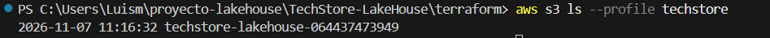
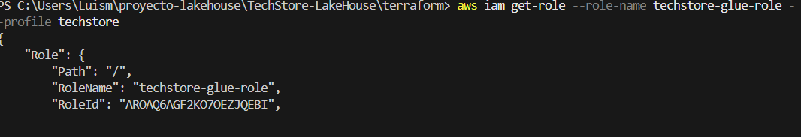
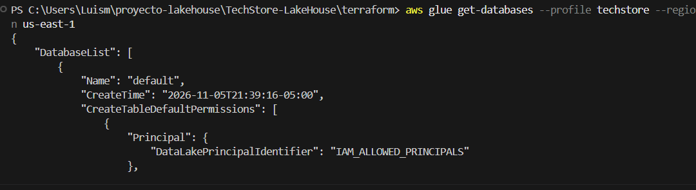

## 8 de noviembre de 2026 - AWS Glue Crawler y organización de Bronze

**Qué hice**

- Definí la estructura de almacenamiento de los datos en Bronze, organizándolos por entidad y lote: `bronze/<entidad>/lote=<N>/`.
- Revisé las rutas S3 que utilizará el Glue Crawler para descubrir las entidades del proyecto, por ejemplo: `bronze/metodos_pago/`.
- Establecí que los objetivos del Crawler apuntan a la carpeta principal de cada entidad, no directamente a los archivos CSV o JSON.
- Definí que el Crawler se utilizará para descubrir los esquemas de Bronze y registrar las tablas en `techstore_bronze`.
- Aclaré el flujo de procesamiento: los Glue Jobs de Spark transformarán los datos y registrarán las tablas Iceberg de Silver y Gold en sus respectivas bases del Data Catalog.
- Definí el procedimiento de carga de datos: utilizar `aws s3 sync` para subir la carpeta local `data/` al prefijo `bronze/` del bucket.
- Revisé cómo manejar las entregas incrementales: el lote 2 se almacena en una ruta diferente al lote 1, evitando sobrescribir los archivos anteriores.
- Confirmé que mi compañero puede ejecutar `terraform init`, `fmt` y `validate` en su entorno sin crear recursos en AWS. El `apply` se mantiene centralizado para evitar conflictos con el estado de Terraform.

**Qué aprendí**

- En S3 las rutas son claves de objetos (*Object Keys*); las carpetas son prefijos virtuales.
- El Crawler puede examinar varios archivos y lotes dentro de la ruta configurada y descubrir sus esquemas.
- El Data Catalog almacena metadatos de las tablas, no los registros. Los datos permanecen en S3.
- Los Glue Jobs pueden registrar las tablas en el Data Catalog al escribir las tablas Iceberg; no necesitan un Crawler para Silver y Gold.
- `aws s3 sync` permite subir los datos por partes. Sin `--delete`, no elimina los objetos existentes que no estén en el origen.
- Los lotes se conservan en Bronze; las operaciones de inserción y actualización mediante MERGE se realizan posteriormente en Silver.

**Qué quedó pendiente / riesgos**

- Terminar la configuración del Glue Crawler en Terraform.
- Ejecutar `terraform plan` y revisar los recursos antes del `apply`.
- Subir los archivos generados a las rutas correspondientes de Bronze.
- Ejecutar el Crawler y verificar que las tablas aparezcan correctamente en `techstore_bronze`.
- Validar que las nueve entidades sean descubiertas correctamente, incluyendo los archivos JSON.

**Evidencia**

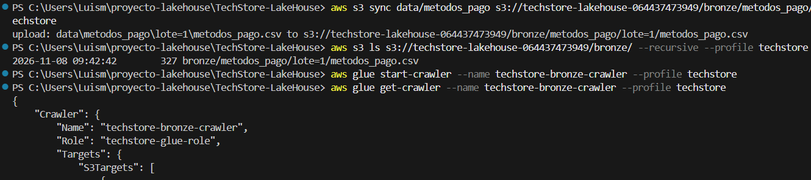
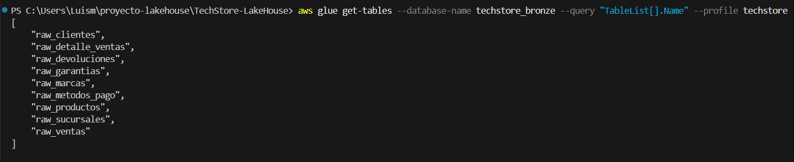

## 9 de noviembre de 2026 - Athena

**Qué hice**

- Creé el workgroup techstore-workgroup (aws_athena_workgroup): resultados en athena-results/, cifrado SSE_S3, motor versión 3, métricas en CloudWatch y tope de 5 GB escaneados por consulta (variable).
- Probé SELECT COUNT(*) FROM raw_ventas: 1.500.000 filas, 137,31 MB escaneados.
- Revisé ProcessedBytes en CloudWatch (AWS/Athena).

**Qué aprendí**

- Athena cobra por datos escaneados (unos 5 USD por TB, mínimo 10 MB por consulta), no por tiempo. La consulta de 137 MB cuesta unos 0,0007 USD.
- Mis primeras consultas corrieron en el workgroup primary y guardaron resultados en un bucket de un taller anterior. Hay que elegir techstore-workgroup.
- tfvars tiene prioridad sobre el default de una variable.
- Con CSV, Athena escanea el archivo completo aunque pida una columna. Parquet/Iceberg debería reducir ese escaneo (por comprobar en Silver).

**Evidencia**

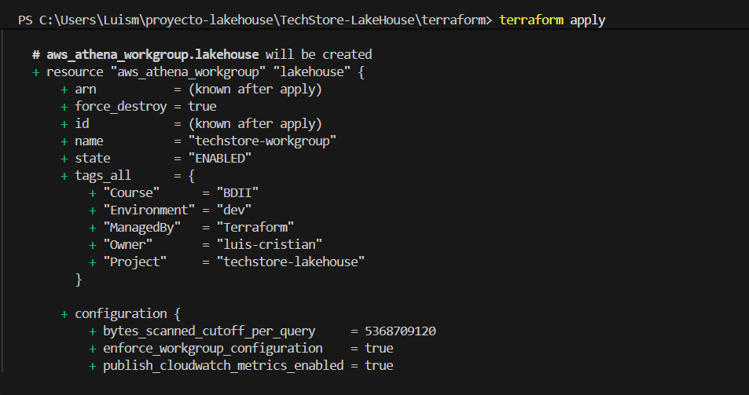
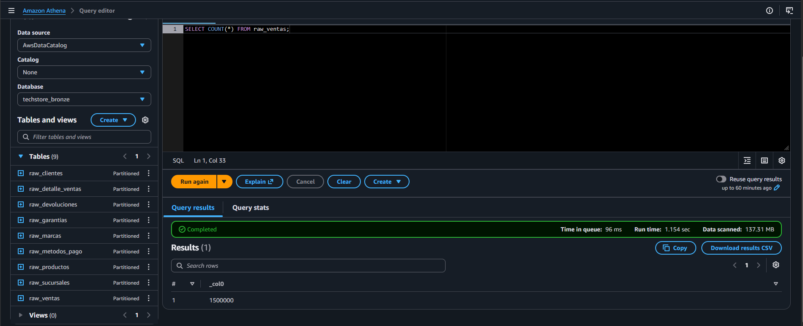
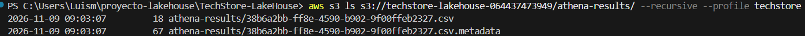

## 10 de noviembre de 2026 - Jobs de Glue (Bronze a Silver)

**Qué hice**

Escribí el job techstore-bronze-to-silver (aws_glue_job): Glue 5.1, 2 workers G.1X, timeout de 20 min y sin reintentos para cuidar el costo.
La config de Iceberg va en Terraform: un local con --conf encadenado (extensión de Iceberg y catálogo glue_catalog sobre el warehouse/ del bucket), más --datalake-formats iceberg y --enable-glue-datacatalog.
Probé el flujo con un script de prueba: leí raw_metodos_pago de Bronze y creé la tabla Iceberg test_metodos_pago en techstore_silver. La corrida duró 1 min 16 s y consumió 0,0425 DPU-horas (unos 0,02 USD).
Definí el job techstore-silver-to-gold (pendiente del script de Cristian).

**Qué aprendí**

Job = orden de trabajo (qué script, qué rol, cuántos workers); cada ejecución es una corrida (run) con su propio id.
Hay dos catálogos: sin prefijo lee las tablas normales de Bronze (CSV/JSON del Crawler); con glue_catalog. se escriben las tablas Iceberg de Silver y Gold.
Una tabla Iceberg son archivos Parquet de datos y archivos de metadatos en warehouse/, más el esquema registrado en el Data Catalog.
Problema encontrado: Athena respeta el encabezado del CSV, pero Spark lo lee como una fila más (salió una fila basura con el id en null). Se filtra con isNotNull() en la llave primaria o leyendo el CSV con header=True.
createOrReplace() solo sirve para la carga inicial; para el lote 2 hay que usar MERGE INTO.
Cada start-job-run crea una corrida nueva y no conviene lanzar varias seguidas: cuestan y no aportan.

**Evidencia**

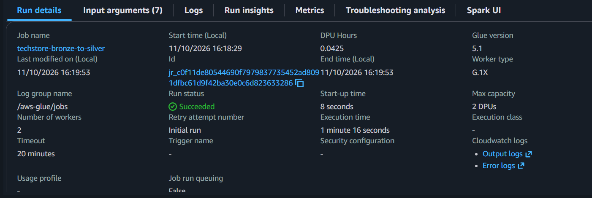
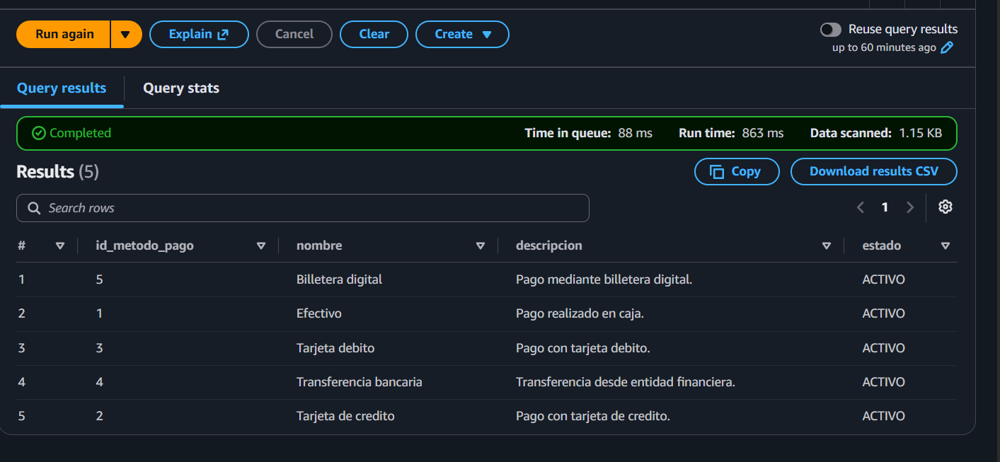

**Qué hice (Gold):**

Escribí el job techstore-silver-to-gold (misma config de Iceberg, lee de techstore_silver y escribe en techstore_gold).
Probé el flujo con un script de prueba: leí test_metodos_pago de Silver y creé test_dim_payment_method en Gold, con payment_key como surrogate key (row_number) y el id original conservado como payment_method_id.
Verifiqué en Athena: 5 filas, payment_key del 1 al 5.
Con esto quedó probado el flujo Bronze, Silver y Gold con una tabla, de punta a punta.

**Qué aprendí:**

Las tablas Iceberg de Silver se leen con el prefijo del catálogo (glue_catalog.), y las tablas normales de Bronze sin prefijo.
Una surrogate key es un número propio de la dimensión, distinto del id original del sistema fuente.
row_number() sin partición mete todos los datos en una sola partición de Spark. Sirve para 5 filas, pero para dim_customer (500.000) puede ser lento o fallar. Hay que ver otra forma.
Terraform no duplica recursos: compara el código con el tfstate y solo crea lo nuevo (el plan decía 1 to add).

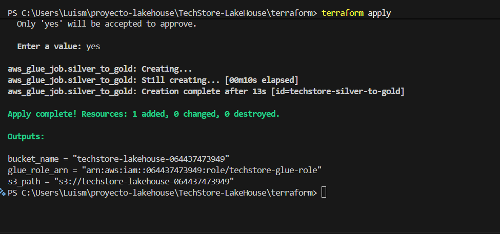

**Qué hice (Step Functions):**
- Creé mediante Terraform la máquina de estados techstore-lakehouse-pipeline para orquestar el flujo del Data Warehouse.
- Configuré dos etapas principales: BronzeToSilver y SilverToGold, ejecutando los Glue Jobs correspondientes.
- Definí las transiciones entre estados para que, al finalizar Bronze a Silver, se ejecute Silver a Gold.
- Asocié la máquina de estados con un rol IAM para permitirle invocar los Glue Jobs.
- Desplegué la infraestructura con Terraform y verifiqué que la máquina de estados quedara creada.

**Qué aprendí:**
- AWS Step Functions permite orquestar servicios y procesos mediante máquinas de estados, definiendo qué tarea se ejecuta y en qué orden.
- Un estado Task representa una tarea que ejecuta un servicio externo; en nuestro caso, inicia un Glue Job.
- StartAt define el primer estado y Next indica cuál se ejecuta después.
- Resource identifica la integración con AWS Glue que ejecuta cada Job.
- Terraform permite definir la máquina de estados, su definición y los permisos IAM como infraestructura reproducible.
- La orquestación centraliza el flujo: en lugar de ejecutar manualmente cada Glue Job, Step Functions coordina su ejecución.

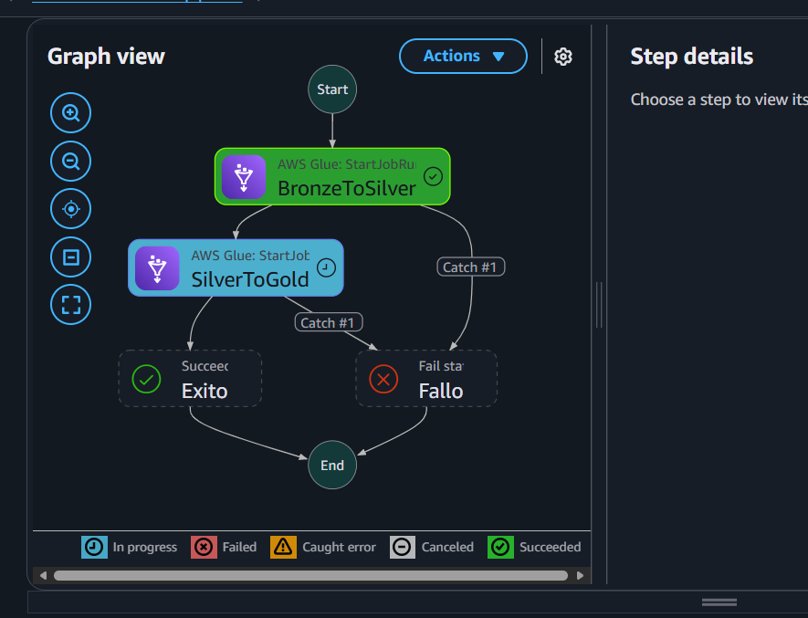

**Qué se hice(Ajustes en Terraform y orquestación)**

- Se actualizaron los nombres de los Glue Jobs a `job-techstore-bronze-to-silver` y `job-techstore-silver-to-gold`.
- Se ajustó el tiempo máximo de ejecución de cada Glue Job de 20 a 12 minutos.
- Se revisó la política IAM de Step Functions para que tenga permisos sobre los nuevos ARN de los Glue Jobs.
- Se verificó que la máquina de estados utilice los nombres actualizados para ejecutar los dos procesos en orden.

**Qué se aprendió:**

- Terraform permite referenciar atributos de otros recursos, como `.name` y `.arn`, sin declarar variables adicionales.
- Al cambiar el nombre de un Glue Job, Terraform debe reemplazar ese recurso porque su nombre es inmutable.
- Step Functions utiliza esos nombres para identificar qué Glue Jobs debe ejecutar.
- El timeout de Glue limita cuánto puede durar un job; no significa que obligatoriamente vaya a ejecutarse durante ese tiempo.

**Estado:** Se revisó el plan de Terraform y los cambios propuestos. Las pruebas funcionales quedan pendientes para ejecutarse con los scripts definitivos del proyecto.

**Evidencia:** 

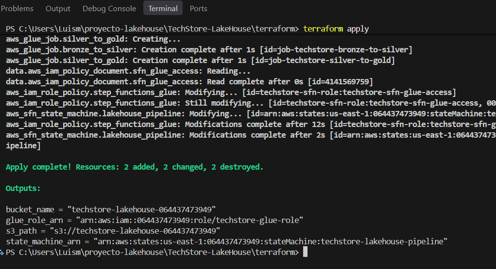
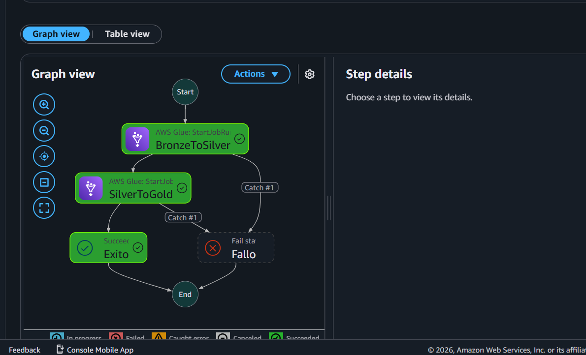

# Bitácora - Cristian Camilo Rangel (Datasets, Scripts, Apache Spark)

Esta sección recopila evidencias de la creación y ejecución de los scripts encargados de generar los datos sintéticos utilizados en el proyecto **TechStore LakeHouse**.

Cada script permite construir conjuntos de datos para representar las diferentes entidades del sistema transaccional y de postventas.

## 1. Generación de clientes

Script encargado de generar registros de clientes para simular la información de los usuarios de la tienda.

## 2. Generación de marcas

Script encargado de crear las marcas asociadas a los productos comercializados por TechStore.

## 3. Generación de productos

Script encargado de generar el catálogo de productos, incluyendo información necesaria para representar los artículos tecnológicos de la tienda.

## 4. Generación de sucursales

Script encargado de generar información de las diferentes sucursales de la cadena de tiendas.

## 5. Generación de métodos de pago

Script encargado de crear los métodos de pago disponibles para las transacciones comerciales.

## 6. Generación de ventas

Script encargado de generar los registros de ventas, simulando las transacciones realizadas en las diferentes sucursales.

## 7. Generación de detalles de ventas

Script encargado de generar los detalles asociados a cada venta, permitiendo representar los productos, cantidades y valores correspondientes a cada transacción.

## 8. Generación de garantías

Script encargado de generar registros de garantías para representar los procesos de postventa relacionados con los productos comercializados.

## 9. Generación de devoluciones

Script encargado de generar registros de devoluciones, simulando solicitudes y procesos de devolución de productos.

