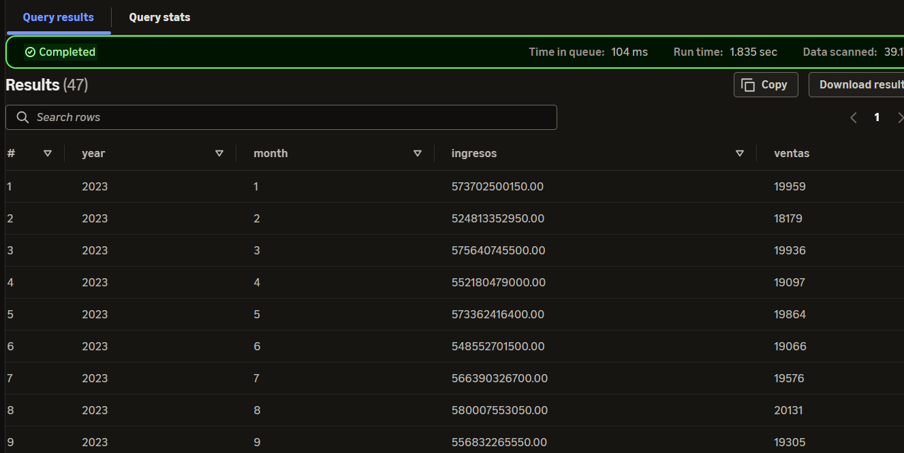
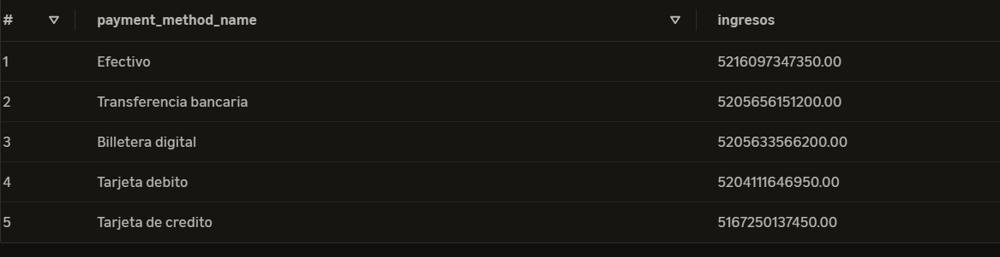
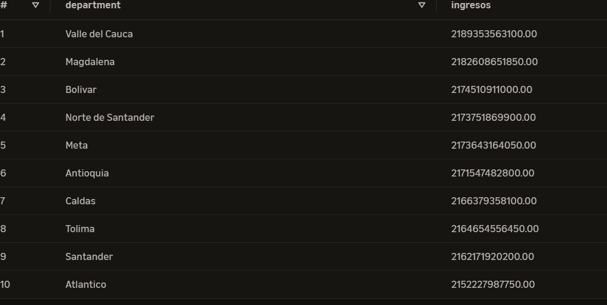
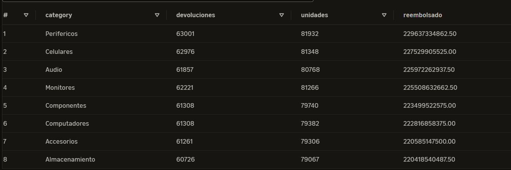
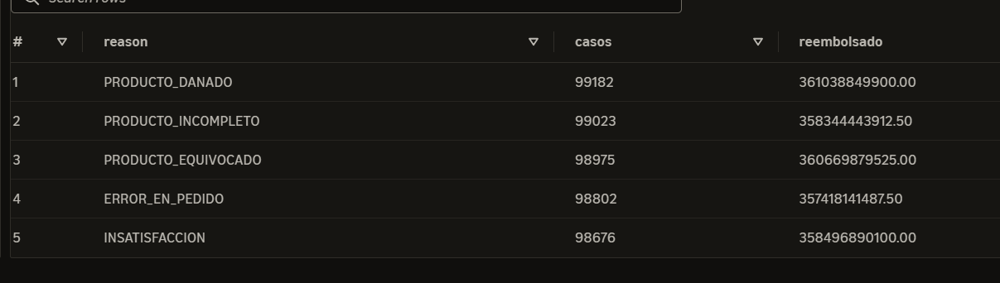
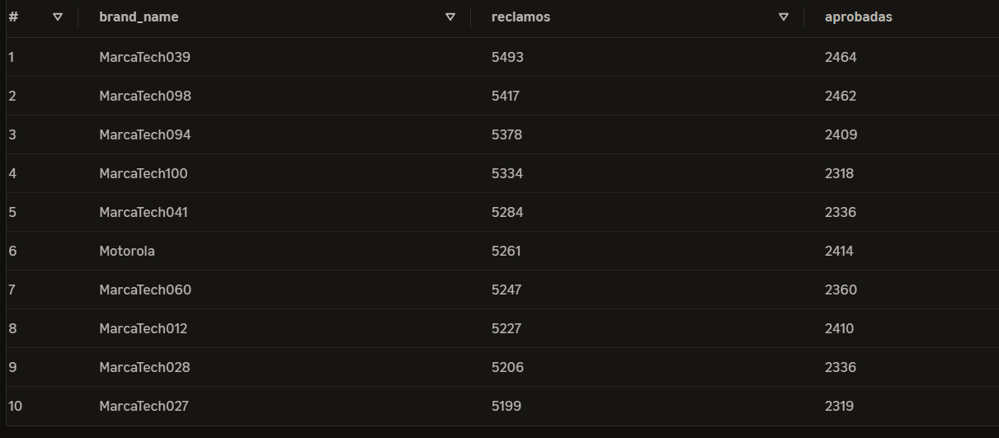

# Consultas analíticas – Capa Gold

Este documento contiene consultas SQL sobre el modelo dimensional de TechStore, orientadas a responder preguntas de negocio mediante Amazon Athena.

## 1. Marcas con mayores ingresos

**Pregunta de negocio:** ¿Qué marcas generan mayores ingresos por ventas?

### Consulta SQL

```sql
SELECT p.brand_name, SUM(f.line_subtotal_amount) AS ingresos
FROM techstore_gold.fact_sales f
JOIN techstore_gold.dim_product p ON f.product_sk = p.product_sk
WHERE f.sale_status = 'COMPLETADA'
GROUP BY p.brand_name ORDER BY ingresos DESC LIMIT 10;
```

### Resultado y análisis


Esta consulta permite identificar las marcas que generan mayores ingresos mediante la unión de la tabla de hechos de ventas con la dimensión de productos, utilizando la clave subrogada `product_sk`. Se filtran únicamente las ventas cuyo estado sea `COMPLETADA`, para considerar las operaciones finalizadas. Posteriormente, se agrupan los registros por nombre de marca y se suman los ingresos generados por sus ventas. Finalmente, se muestran las diez marcas con mayores ingresos.


---

## 2. Productos con mayor rotación

**Pregunta de negocio:** ¿Cuáles son los productos con mayor cantidad de unidades vendidas?

### Consulta SQL

```sql
SELECT p.product_name, SUM(f.quantity) AS unidades
FROM techstore_gold.fact_sales f
JOIN techstore_gold.dim_product p ON f.product_sk = p.product_sk
WHERE f.sale_status = 'COMPLETADA'
GROUP BY p.product_name ORDER BY unidades DESC LIMIT 10;
```

### Resultado y análisis


Esta consulta permite identificar los productos más vendidos mediante la unión de la tabla de hechos de ventas con la dimensión de productos, utilizando la clave subrogada `product_sk`. Se filtran únicamente las ventas cuyo estado sea `COMPLETADA`, para considerar las operaciones finalizadas. Posteriormente, se agrupan los registros por nombre del producto y se suman las unidades vendidas de cada uno. Finalmente, se muestran los diez productos con mayor volumen de ventas.

---

## 3. Sucursales con mayores ventas de computadores

**Pregunta de negocio:** ¿Qué sucursales venden más computadores?

### Consulta SQL

```sql
SELECT b.branch_name, SUM(f.quantity) AS computadores
FROM techstore_gold.fact_sales f
JOIN techstore_gold.dim_product p ON f.product_sk = p.product_sk
JOIN techstore_gold.dim_branch b ON f.branch_sk = b.branch_sk
WHERE p.category = 'Computadores' AND f.sale_status = 'COMPLETADA'
GROUP BY b.branch_name ORDER BY computadores DESC LIMIT 10;
```

### Resultado y análisis


Esta consulta permite identificar las sucursales que registran el mayor volumen de ventas de computadores mediante la unión de la tabla de hechos de ventas con las dimensiones de productos y sucursales, utilizando sus respectivas claves subrogadas. Se filtran únicamente los productos de la categoría `Computadores` y las ventas con estado `COMPLETADA`. Posteriormente, se agrupan los registros por nombre de sucursal y se suman las unidades vendidas. Finalmente, se muestran las sucursales con mayor cantidad de computadores vendidos.

---

## 4. Dinero reembolsado por devoluciones

**Pregunta de negocio:** ¿Cuánto dinero se ha reembolsado por devoluciones según su estado?

### Consulta SQL

```sql
SELECT status, COUNT(*) AS devoluciones, SUM(refund_amount) AS reembolsado
FROM techstore_gold.fact_returns
GROUP BY status ORDER BY reembolsado DESC;
```

### Resultado y análisis


Esta consulta permite analizar las devoluciones agrupándolas según su estado. Para ello, se utiliza directamente la tabla de hechos `fact_returns`, sin necesidad de unir otras tablas. Se cuenta la cantidad de devoluciones registradas en cada estado y se suman los valores reembolsados, permitiendo conocer cuántas devoluciones existen y cuánto dinero representan según su estado. Finalmente, los resultados se ordenan de mayor a menor según el valor reembolsado.

---

## 5. Productos con mayor margen bruto

**Pregunta de negocio:** ¿Qué productos generan mayor ganancia bruta?

### Consulta SQL

```sql
SELECT p.product_name,
       SUM(f.line_subtotal_amount - f.quantity * p.acquisition_cost) AS margen
FROM techstore_gold.fact_sales f
JOIN techstore_gold.dim_product p ON f.product_sk = p.product_sk
WHERE f.sale_status = 'COMPLETADA'
GROUP BY p.product_name ORDER BY margen DESC LIMIT 10;
```

### Resultado y análisis


Esta consulta permite identificar los productos que generan mayor ganancia bruta mediante la unión de la tabla de hechos de ventas con la dimensión de productos, utilizando la clave subrogada `product_sk`. Se consideran únicamente las ventas con estado `COMPLETADA`. Posteriormente, se calcula la ganancia bruta restando al subtotal de cada línea de venta el costo de adquisición de las unidades vendidas. Los resultados se agrupan por nombre del producto, se suman las ganancias obtenidas y se ordenan de mayor a menor, mostrando finalmente los diez productos con mayor ganancia bruta.


## 6. Ingresos por mes

**Pregunta de negocio:** ¿Cómo evolucionan los ingresos y la cantidad de ventas de TechStore a lo largo del tiempo?

### Consulta SQL

```sql
SELECT d.year, d.month, SUM(f.line_subtotal_amount) AS ingresos,
       COUNT(DISTINCT f.sale_id) AS ventas
FROM techstore_gold.fact_sales f
JOIN techstore_gold.dim_date d ON f.date_sk = d.date_sk
WHERE f.sale_status = 'COMPLETADA'
GROUP BY d.year, d.month
ORDER BY d.year, d.month;
```

### Resultado y análisis



Esta consulta permite analizar la evolución mensual de los ingresos y el volumen de ventas de TechStore mediante la unión de la tabla de hechos de ventas con la dimensión de fechas, utilizando la clave subrogada `date_sk`. Se consideran únicamente las ventas con estado `COMPLETADA`. Los ingresos se calculan sumando los subtotales de las líneas de venta, mientras que la cantidad de ventas se obtiene contando los identificadores de venta sin duplicados. Finalmente, los resultados se agrupan por año y mes y se ordenan cronológicamente, permitiendo identificar tendencias y variaciones en el comportamiento comercial.

---

## 7. Ingresos por método de pago

**Pregunta de negocio:** ¿Qué métodos de pago generan mayores ingresos para TechStore?

### Consulta SQL

```sql
SELECT pm.payment_method_name, SUM(f.line_subtotal_amount) AS ingresos
FROM techstore_gold.fact_sales f
JOIN techstore_gold.dim_payment_method pm
    ON f.payment_method_sk = pm.payment_method_sk
WHERE f.sale_status = 'COMPLETADA'
GROUP BY pm.payment_method_name
ORDER BY ingresos DESC;
```

### Resultado y análisis



Esta consulta permite identificar los métodos de pago asociados con mayores ingresos mediante la unión de la tabla de hechos de ventas con la dimensión de métodos de pago, utilizando la clave subrogada `payment_method_sk`. Se filtran únicamente las ventas con estado `COMPLETADA` y se suman los subtotales de las líneas de venta correspondientes a cada método. Los resultados se agrupan por nombre del método de pago y se ordenan de mayor a menor según los ingresos generados. Esto permite conocer la participación de cada método de pago en las ventas de la empresa.

---

## 8. Ingresos por departamento del cliente

**Pregunta de negocio:** ¿En qué departamentos se concentran los mayores ingresos de TechStore?

### Consulta SQL

```sql
SELECT c.department, SUM(f.line_subtotal_amount) AS ingresos
FROM techstore_gold.fact_sales f
JOIN techstore_gold.dim_customer c
    ON f.customer_sk = c.customer_sk
WHERE f.sale_status = 'COMPLETADA'
GROUP BY c.department
ORDER BY ingresos DESC
LIMIT 10;
```

### Resultado y análisis



Esta consulta permite analizar la distribución geográfica de los ingresos mediante la unión de la tabla de hechos de ventas con la dimensión de clientes, utilizando la clave subrogada `customer_sk`. Se consideran únicamente las ventas completadas y se suman los subtotales de las líneas de venta asociadas a los clientes de cada departamento. Posteriormente, los resultados se agrupan por departamento y se ordenan de mayor a menor según los ingresos generados, mostrando los diez departamentos con mayores valores. Este análisis permite identificar las regiones que representan una mayor contribución económica para la empresa.

---

## 9. Devoluciones por categoría de producto

**Pregunta de negocio:** ¿Qué categorías de productos presentan mayores niveles de devolución y cuánto dinero representan los reembolsos?

### Consulta SQL

```sql
SELECT p.category, COUNT(*) AS devoluciones,
       SUM(r.returned_quantity) AS unidades,
       SUM(r.refund_amount) AS reembolsado
FROM techstore_gold.fact_returns r
JOIN techstore_gold.dim_product p
    ON r.product_sk = p.product_sk
GROUP BY p.category
ORDER BY reembolsado DESC;
```

### Resultado y análisis



Esta consulta permite analizar el comportamiento de las devoluciones según la categoría de los productos mediante la unión de la tabla de hechos de devoluciones con la dimensión de productos, utilizando la clave subrogada `product_sk`. Para cada categoría se contabilizan los registros de devolución, se suman las unidades devueltas y se calcula el valor total de los reembolsos realizados. Finalmente, los resultados se agrupan por categoría y se ordenan de mayor a menor según el dinero reembolsado. Este análisis permite identificar las categorías que representan un mayor impacto económico asociado a las devoluciones.

---

## 10. Motivos de devolución más frecuentes

**Pregunta de negocio:** ¿Cuáles son los motivos que generan más devoluciones en TechStore y qué valor económico representan?

### Consulta SQL

```sql
SELECT reason, COUNT(*) AS casos,
       SUM(refund_amount) AS reembolsado
FROM techstore_gold.fact_returns
GROUP BY reason
ORDER BY casos DESC;
```

### Resultado y análisis



Esta consulta permite identificar los motivos más frecuentes de devolución y su impacto económico utilizando directamente la tabla de hechos `fact_returns`. Se agrupan los registros por motivo de devolución, se contabiliza la cantidad de casos y se suma el valor de los reembolsos asociados a cada motivo. Los resultados se ordenan de mayor a menor según la cantidad de casos, permitiendo reconocer las principales causas de devolución y analizar cuánto dinero representan para la empresa. Esta información puede contribuir a identificar problemas recurrentes relacionados con los productos o el servicio ofrecido.

---

## 11. Garantías por marca

**Pregunta de negocio:** ¿Qué marcas presentan más reclamos de garantía y cuántos de estos son aprobados?

### Consulta SQL

```sql
SELECT p.brand_name, COUNT(*) AS reclamos,
       SUM(CASE WHEN w.status = 'APROBADA' THEN 1 ELSE 0 END) AS aprobadas
FROM techstore_gold.fact_warranties w
JOIN techstore_gold.dim_product p
    ON w.product_sk = p.product_sk
GROUP BY p.brand_name
ORDER BY reclamos DESC
LIMIT 10;
```

### Resultado y análisis



Esta consulta permite analizar los reclamos de garantía asociados a las diferentes marcas de productos mediante la unión de la tabla de hechos de garantías con la dimensión de productos, utilizando la clave subrogada `product_sk`. Para cada marca se contabiliza el total de reclamos registrados y se identifican aquellos cuyo estado corresponde a `APROBADA`, utilizando una expresión condicional `CASE`. Los resultados se agrupan por marca y se ordenan de mayor a menor según la cantidad de reclamos, mostrando las diez marcas con más solicitudes. Este análisis permite conocer qué marcas concentran una mayor cantidad de reclamaciones y cuántas de ellas han recibido una respuesta favorable.
