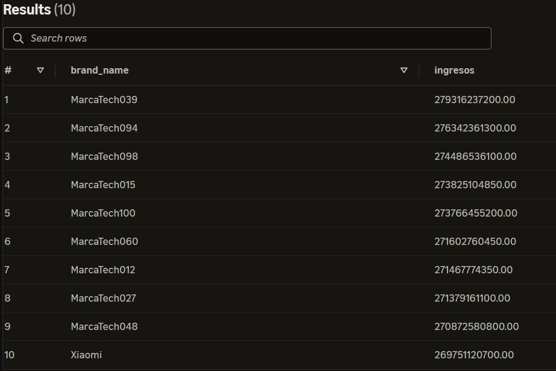
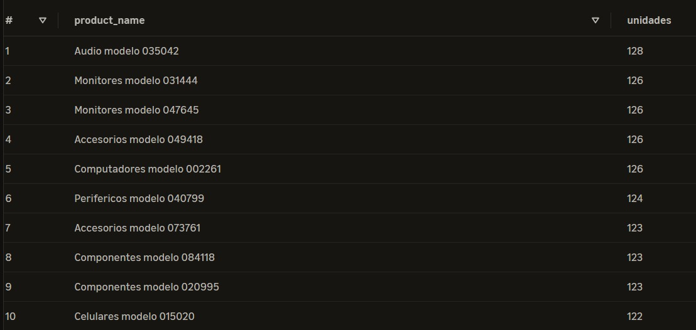
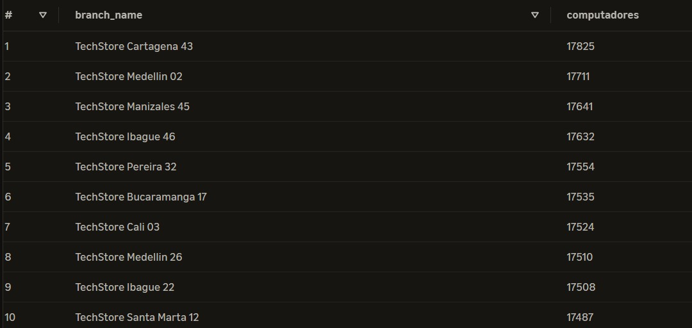
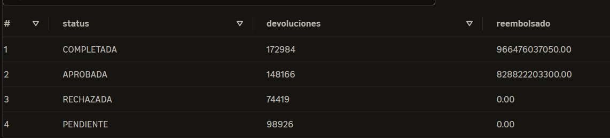
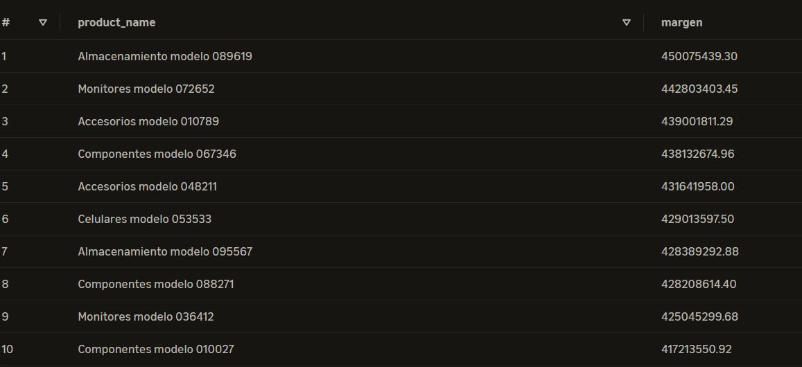

# Consultas analíticas – Capa Gold

Este documento contiene consultas SQL sobre el modelo dimensional de TechStore, orientadas a responder preguntas de negocio mediante Amazon Athena.

## 1. Marcas con mayores ingresos

**Pregunta de negocio:** ¿Qué marcas generan mayores ingresos por ventas?

### Consulta SQL

```sql
SELECT p.brand_name, SUM(f.line_subtotal_amount) AS ingresos
FROM techstore_gold.fact_sales f
JOIN techstore_gold.dim_product p ON f.product_sk = p.product_sk
WHERE f.sale_status = 'COMPLETADA'
GROUP BY p.brand_name ORDER BY ingresos DESC LIMIT 10;
```

### Resultado y análisis



Esta consulta permite identificar las marcas que generan mayores ingresos mediante la unión de la tabla de hechos de ventas con la dimensión de productos, utilizando la clave subrogada `product_sk`. Se filtran únicamente las ventas cuyo estado sea `COMPLETADA`, para considerar las operaciones finalizadas. Posteriormente, se agrupan los registros por nombre de marca y se suman los ingresos generados por sus ventas. Finalmente, se muestran las diez marcas con mayores ingresos.


---

## 2. Productos con mayor rotación

**Pregunta de negocio:** ¿Cuáles son los productos con mayor cantidad de unidades vendidas?

### Consulta SQL

```sql
SELECT p.product_name, SUM(f.quantity) AS unidades
FROM techstore_gold.fact_sales f
JOIN techstore_gold.dim_product p ON f.product_sk = p.product_sk
WHERE f.sale_status = 'COMPLETADA'
GROUP BY p.product_name ORDER BY unidades DESC LIMIT 10;
```

### Resultado y análisis




Esta consulta permite identificar los productos más vendidos mediante la unión de la tabla de hechos de ventas con la dimensión de productos, utilizando la clave subrogada `product_sk`. Se filtran únicamente las ventas cuyo estado sea `COMPLETADA`, para considerar las operaciones finalizadas. Posteriormente, se agrupan los registros por nombre del producto y se suman las unidades vendidas de cada uno. Finalmente, se muestran los diez productos con mayor volumen de ventas.

---

## 3. Sucursales con mayores ventas de computadores

**Pregunta de negocio:** ¿Qué sucursales venden más computadores?

### Consulta SQL

```sql
SELECT b.branch_name, SUM(f.quantity) AS computadores
FROM techstore_gold.fact_sales f
JOIN techstore_gold.dim_product p ON f.product_sk = p.product_sk
JOIN techstore_gold.dim_branch b ON f.branch_sk = b.branch_sk
WHERE p.category = 'Computadores' AND f.sale_status = 'COMPLETADA'
GROUP BY b.branch_name ORDER BY computadores DESC LIMIT 10;
```

### Resultado y análisis




Esta consulta permite identificar las sucursales que registran el mayor volumen de ventas de computadores mediante la unión de la tabla de hechos de ventas con las dimensiones de productos y sucursales, utilizando sus respectivas claves subrogadas. Se filtran únicamente los productos de la categoría `Computadores` y las ventas con estado `COMPLETADA`. Posteriormente, se agrupan los registros por nombre de sucursal y se suman las unidades vendidas. Finalmente, se muestran las sucursales con mayor cantidad de computadores vendidos.

---

## 4. Dinero reembolsado por devoluciones

**Pregunta de negocio:** ¿Cuánto dinero se ha reembolsado por devoluciones según su estado?

### Consulta SQL

```sql
SELECT status, COUNT(*) AS devoluciones, SUM(refund_amount) AS reembolsado
FROM techstore_gold.fact_returns
GROUP BY status ORDER BY reembolsado DESC;
```

### Resultado y análisis



Esta consulta permite analizar las devoluciones agrupándolas según su estado. Para ello, se utiliza directamente la tabla de hechos `fact_returns`, sin necesidad de unir otras tablas. Se cuenta la cantidad de devoluciones registradas en cada estado y se suman los valores reembolsados, permitiendo conocer cuántas devoluciones existen y cuánto dinero representan según su estado. Finalmente, los resultados se ordenan de mayor a menor según el valor reembolsado.

---

## 5. Productos con mayor margen bruto

**Pregunta de negocio:** ¿Qué productos generan mayor ganancia bruta?

### Consulta SQL

```sql
SELECT p.product_name,
       SUM(f.line_subtotal_amount - f.quantity * p.acquisition_cost) AS margen
FROM techstore_gold.fact_sales f
JOIN techstore_gold.dim_product p ON f.product_sk = p.product_sk
WHERE f.sale_status = 'COMPLETADA'
GROUP BY p.product_name ORDER BY margen DESC LIMIT 10;
```

### Resultado y análisis



Esta consulta permite identificar los productos que generan mayor ganancia bruta mediante la unión de la tabla de hechos de ventas con la dimensión de productos, utilizando la clave subrogada `product_sk`. Se consideran únicamente las ventas con estado `COMPLETADA`. Posteriormente, se calcula la ganancia bruta restando al subtotal de cada línea de venta el costo de adquisición de las unidades vendidas. Los resultados se agrupan por nombre del producto, se suman las ganancias obtenidas y se ordenan de mayor a menor, mostrando finalmente los diez productos con mayor ganancia bruta.